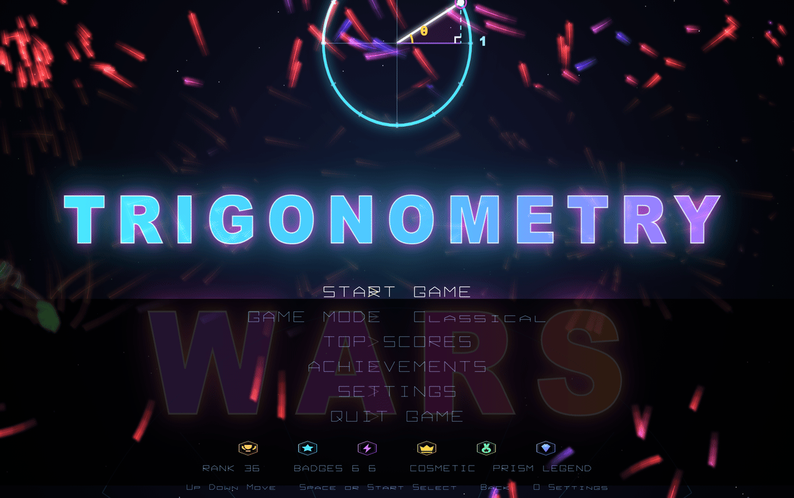
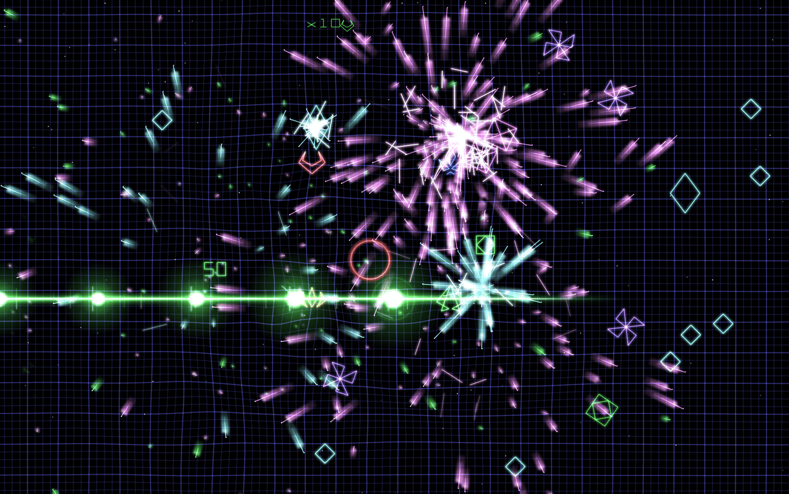
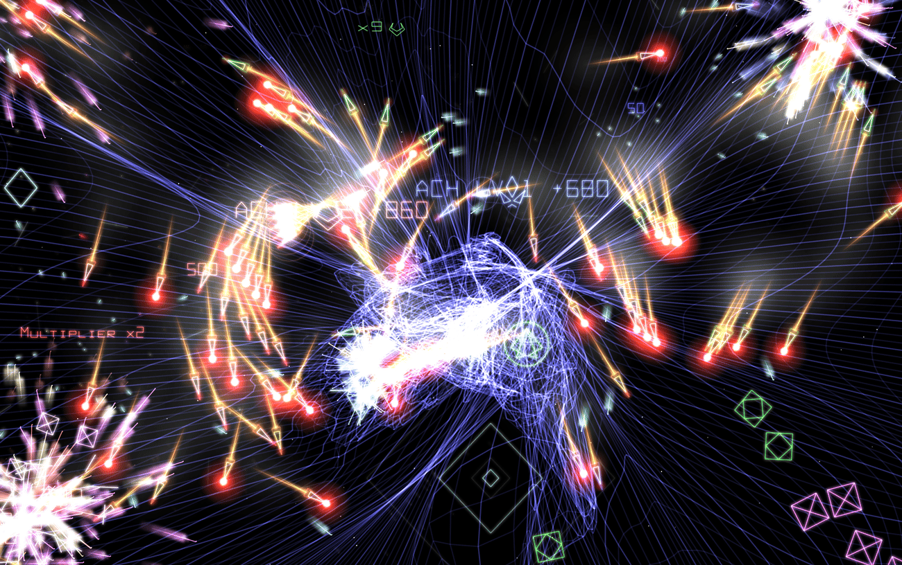
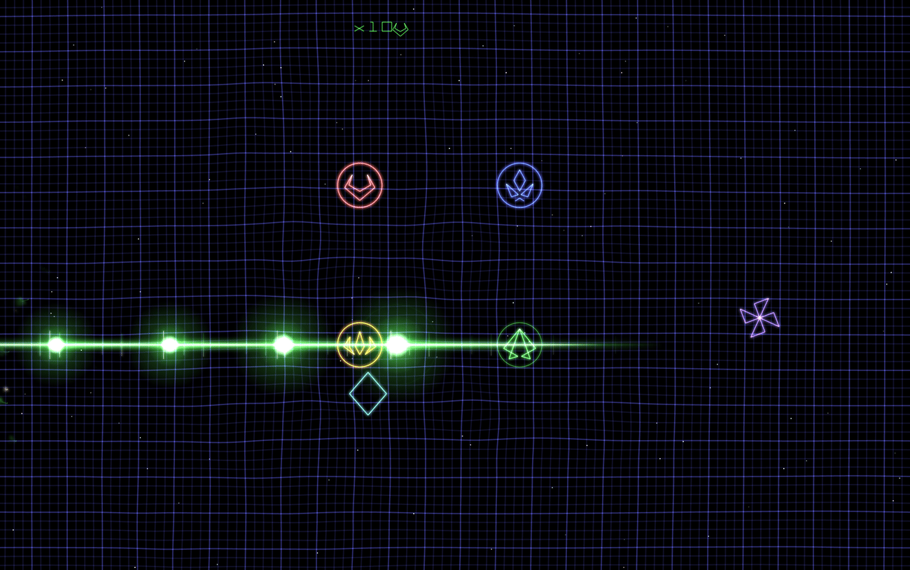
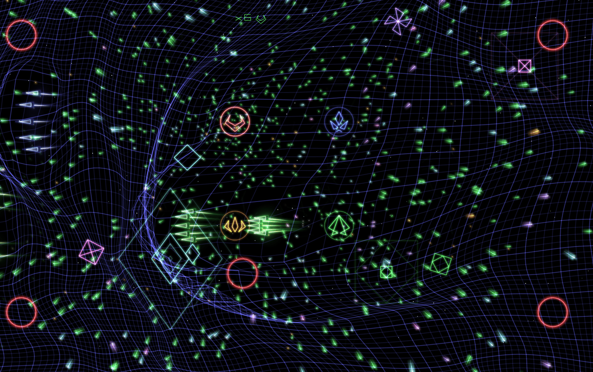

# Trigonometry Wars

Trigonometry Wars is an open-source, twin-stick arena shooter inspired by
*Geometry Wars*. Control a small neon ship on a vector-style grid, dodge swarms
of enemies, survive as long as you can and chase the high score.

This repository began as an **SDL3** (previously SDL2) port of the original
[OpenGW project](https://sourceforge.net/projects/opengw/), modernised to
C++20, and is now developed as **Trigonometry Wars**.



The renderer has been modernised to **OpenGL 3.3 core profile**: the legacy
fixed-function pipeline (`glBegin`/`glEnd`, GLU, CPU blur read-back) has been
replaced by a small shader/VAO/VBO backend (`src/render/gl3.{h,cpp}`) and the
"bloom" glow is produced with a GPU framebuffer-object Gaussian blur — no
more per-frame CPU image read-back.

An alternative **bgfx render backend** (`src/render/bgfx_backend.cpp`) can be
selected with `USE_BGFX=1`. It implements exactly the same `gfx_*` API (see
`src/render/gl3.h`), so no game code changes: vertex transform, wide lines and
points, batching, textures and the glow/blur pass are simply driven through
bgfx. On macOS bgfx has no OpenGL backend any more (upstream removed it), so
that build renders with **Metal** — `make run-bgfx` gives you the Metal path
with the game's existing look. `src/render/bgfx_bridge.{hpp,cpp}` owns the bgfx
device (window/layer, resize, vsync, frame submission).

## Features

- Fast, glow-heavy vector rendering (grid, particles, enemies) with a GPU
  blur post-process pass for the "Bloom" look
- Multiple enemy types: grunts, wanderers, weavers, snakes, spinners,
  repulsors, black holes / gravity wells, mayflies and more
- Dynamic wave variety: anti-repeat wave selection, mixed support waves and
  varied swarm entry patterns to reduce repetitive encounters
- Weapons, bombs, shields, score multipliers and gravity wells to destroy
- 1–4 player support:
  - Single player
  - Multiplayer co-op
  - Multiplayer versus
- Keyboard **and** gamepad (hot-plug support for up to 4 pads, standard A/B
  menu buttons, device-aware prompts, rumble and controller settings)
- Attract mode and persistent high scores
- **Top Scores screen** (from the title menu) and a **Settings screen**
  (press `Backspace`/`O` or the gamepad **Back** button on the title screen):
  fullscreen, window resolution, glow/bloom, per-system smoothing, volume,
  vibration and prompt style — saved to `settings.cfg`
- **Controls/Help screen** from the title and pause menus, plus a short
  device-aware guide at the start of a match
- Cross-platform: macOS, Linux, Windows (MSVC) and AmigaOS 4

## Screenshots

| Weapons | Enemies & gravity |
| --- | --- |
|  |  |
|  |  |

*Captured in-game: laser volleys and impact bursts, a homing-missile swarm
closing on a target, the piercing beam weapon, and gravity wells warping the
whole grid.*

## Dependencies

- A C++20 compiler (`g++` / `clang++`)
- [SDL3](https://github.com/libsdl-org/SDL) development files, validated with
  SDL3 3.4.16+
- OpenGL 3.3 **core profile** support (functions are loaded at runtime via
  `SDL_GL_GetProcAddress`, so no GLEW/GLAD and no GLU is required)
- Optional (macOS, for `USE_BGFX=1` builds):
  [bgfx](https://github.com/bkaradzic/bgfx) built with Metal support, plus its
  `shaderc` tool if you want to change the shaders

## Building

The default `Makefile` auto-detects your OS and picks up SDL3 either from the
macOS framework install or via `pkg-config` (e.g. Homebrew / Linux distro
packages).

This repository is currently validated against SDL3 3.4.16.

```sh
make            # build the game (produces ./trigwars)
make run        # build and run
make capture    # debug build + save one rendered frame as capture.png
make clean      # remove build objects and the binary
make help       # show available targets

# Build with the bgfx interop host path enabled
make USE_BGFX=1
make run-bgfx   # build and run with USE_BGFX=1 (produces ./trigwars-bgfx)
```

For `USE_BGFX=1` the bgfx paths are derived from `BGFX_HOME` (a local bgfx
checkout, default `~/projects/bgfx`); `BGFX_LIBDIR`, `BGFX_CFLAGS` and
`BGFX_LIBS` can be overridden individually. `make bgfx-env` prints what is being
used:

```sh
make USE_BGFX=1                       # ~/projects/bgfx by default
make USE_BGFX=1 BGFX_HOME="$HOME/src/bgfx"
make USE_BGFX=1 BGFX_LIBS="..."       # e.g. a shared bgfx library
make USE_BGFX=1 bgfx-env              # show the detected paths and flags
```

bgfx is linked statically, so all three of `libbgfx`, `libbimg` and `libbx` are
on the link line (`bgfx` calls into `bimg` for image handling and into `bx`);
`tools/check_bgfx_libs.sh` inspects the flags before linking and explains the
usual mistake — a partial list, which otherwise only shows up as a wall of
`undefined symbols: bimg::...`. A `BGFX_LIBS` that names a static `libbgfx` but
drops one of its companions (a stale `export` in your shell, say) is completed
from `BGFX_LIBDIR` with a note from make; a complete list, or one naming a
*shared* bgfx (which bundles bimg and bx), is used exactly as given. Build the
libraries once with `make -C "$BGFX_HOME"` (add `shaderc` if you want to
regenerate the shaders).

`USE_BGFX=1` builds use their own object directory (`obj-bgfx/`) and their own
binary (`trigwars-bgfx`, so neither build can be mistaken for — or silently
reused as — the other), and are currently **macOS-only**: the backend renders
with bgfx/Metal and the embedded shaders are compiled for Metal (see
`tools/compile_shaders.sh`). On other platforms use the default `make` (OpenGL
backend).

> **Run from the project root.** The game loads `assets/sounds/` and
> `assets/images/` and writes its `scores.sav` high-score file relative to the
> current working directory, so launch it from here (or from a folder that
> contains those folders).

> **macOS `run-bgfx` note.** The bgfx build renders with **Metal** (bgfx has no
> OpenGL backend on Apple platforms) and keeps the game's existing look: the
> same CPU-side fixed-function emulation, the same glow/blur pass, just driven
> through bgfx. Close other GPU-heavy apps if you see frame pacing oddities —
> vsync is applied through the bgfx swap chain.

### macOS

Either install SDL3 with Homebrew:

```sh
brew install sdl3
make
```

…or install the official `SDL3.framework` into `/Library/Frameworks/` and
build with the framework-based makefile:

```sh
make -f makefile.macos
```

### Linux

One-command setup (recommended):

```sh
./tools/install_dependencies.sh
make run
```

```sh
# Debian / Ubuntu
sudo apt install libsdl3-dev libgl1-mesa-dev
make

# Fedora
sudo dnf install SDL3-devel mesa-libGL-devel
make
```

There is also a standalone `makefile.linux`.

### Windows

Use the standalone `makefile.win` with MinGW (with SDL3 available on the
include/library path).

### AmigaOS 4

Use `makefile.os4`.

### Debug builds and frame capture

`make DEBUG=1` builds `./trigwars-debug` (in its own `obj-debug/` tree) with
the `TW_DEBUG` diagnostics compiled in: per-second timing logs on stderr,
renderer counters, and the `TW_*` environment variables below for reproducing
and capturing what you see. Release builds carry none of it.

```sh
make DEBUG=1
./trigwars-debug                         # timing logs on stderr

# Jump straight into a match / kill the player for repro:
TW_FORCE_MATCH=1 TW_MODE_INDEX=1 ./trigwars-debug
TW_SEED=12345 TW_FORCE_DEATH=1 ./trigwars-debug

# Hands-free firing for gameplay captures (weapon 3 = laser, power 5):
TW_FORCE_MATCH=1 TW_AUTOFIRE=3 TW_AUTOFIRE_POWER=5 ./trigwars-debug
```

`TW_CAPTURE=<file.png>` renders a frame to a PNG and exits (OpenGL backend
only). The README screenshots are produced with it:

```sh
# title screen
TW_CAPTURE=/tmp/title.png TW_CAPTURE_START=150 ./trigwars-debug

# a burst of gameplay frames (shot_0300.png, shot_0360.png, ...)
TW_FORCE_MATCH=1 TW_AUTOFIRE=2 \
  TW_CAPTURE=/tmp/shot.png TW_CAPTURE_START=300 \
  TW_CAPTURE_EVERY=60 TW_CAPTURE_COUNT=5 ./trigwars-debug
```

`make capture` is a shortcut for the first case:
`make capture CAPTURE_START=150 CAPTURE_PATH=/tmp/title.png`.

| Variable | Meaning |
| --- | --- |
| `TW_SEED=<n>` | fixed RNG seed, for repeatable runs |
| `TW_FORCE_MATCH=1` | leave attract mode and start a match after ~2 s |
| `TW_MODE_INDEX=<n>` | gameplay mode index used with `TW_FORCE_MATCH` |
| `TW_FORCE_DEATH=1` | destroy player 1 after ~3 s of play |
| `TW_AUTOFIRE=<0..3>` | player 1 holds the trigger with that weapon equipped |
| `TW_AUTOFIRE_POWER=<1..5>` | pins that weapon's power level |
| `TW_CAPTURE=<file.png>` | capture a frame to PNG, then exit |
| `TW_CAPTURE_START=<n>` | frame number of the first capture (default 60) |
| `TW_CAPTURE_EVERY=<n>` | capture again every n frames (default: one shot) |
| `TW_CAPTURE_COUNT=<n>` | number of shots to write (default 1, 0 = until quit) |
| `TW_SKIP_GLOW=1` | bgfx backend: skip the whole bloom pass (isolate its cost) |
| `TW_SKIP_BLUR=1` | bgfx backend: skip the Gaussian blur stage |
| `TW_SKIP_COMPOSITE=1` | bgfx backend: skip compositing the glow back in |

The startup smoke test is also available in release builds:
`TW_SMOKETEST=1 ./trigwars` renders a few frames and exits (`make smoke` wraps
that, using `xvfb-run` on headless Linux).

## Controls

| Action        | Keyboard              | Gamepad               |
| ------------- | --------------------- | --------------------- |
| Move          | `W` `A` `S` `D`       | Left stick / D-pad    |
| Aim / fire    | Arrow keys            | Right stick           |
| Bomb          | `Space`               | Right trigger (`RT`)  |
| Start player  | `1` `2` `3` `4`       | Start or South/A      |
| Confirm       | `Enter` / `Space`     | South/A               |
| Back / cancel | `Backspace` / `Esc`   | East/B or Back        |
| Pause         | `P`                   | Start                 |
| Options/help  | `O` (title/menus)     | Back / View (menus)   |

Menus can be navigated with the analog stick **or** the D-pad (the D-pad also
drives the ship in-game). Prompt style defaults to **Auto**, which follows the
device you last used and switches to gamepad glyphs as soon as a pad produces
input.

### Controller settings

Settings contains a **CONTROLLER** group:

- **VIBRATION** — enables rumble on bombs and player hits/deaths.
- **PROMPTS** — `AUTO`, `GAMEPAD` or `KEYBOARD`. Auto follows the last used
  device; the other values force one style.

The title and pause menus both have a **CONTROLS** entry with the full control
reference and the currently connected pads. Old `settings.cfg` files remain
compatible; the new keys are `vibration` and `promptStyle`.

## Project layout

Sources are grouped under `src/` and runtime assets under `assets/`:

```
Makefile, makefile.*   # build entry points (`make` from the repo root)
src/
  core/      main loop, game state, camera, input, settings, high scores
  entities/  entity base, player ships, enemies and projectiles
  render/    scene, grid/stars background, GPU glow, textures, fonts,
             gl3.{h,cpp}          (modern OpenGL 3.3 core backend, default)
             bgfx_backend.cpp     (bgfx backend, Metal on macOS — USE_BGFX=1)
             bgfx_bridge.{hpp,cpp}(bgfx device / window / frame submission)
             shaders/             bgfx shader sources + embedded Metal binaries
  audio/     SDL3 sound mixer
  ui/        menus (game-type select)
  math/      vectors/matrices, math helpers, shared constants
  vendor/    lodepng (third-party PNG codec)
assets/
  images/    runtime images (marquee, icon); screenshots/ holds the in-game
             captures used by README.md
  sounds/    runtime sounds (.wav)
tools/
  classicalcfg_check.cpp      standalone classical.cfg loader check
  compile_shaders.sh          regenerate the embedded bgfx shaders (needs shaderc)
  check_bgfx_libs.sh          validate the bgfx link flags before linking
  bgfx_backend_test.cpp       headless bgfx backend verification
  run_bgfx_backend_test.sh    build + run the above
  bgfx_frame_bench.cpp        headless per-frame render cost benchmark
  run_bgfx_frame_bench.sh     build + run the above
```

Run `make` from the repo root so the CWD-relative `assets/…` and
`scores.sav` paths resolve.

## Renderer backends

Both backends implement the same API (`src/render/gl3.h`), so all game code is
shared:

| | default (`make`) | `USE_BGFX=1` (`make run-bgfx`) |
| --- | --- | --- |
| API | OpenGL 3.3 core | bgfx (Metal on macOS) |
| Context | SDL GL context | SDL Metal view / bgfx swap chain |
| Shaders | GLSL strings compiled at runtime | pre-compiled bgfx blobs (`src/render/shaders/*.bin.h`) |
| Objects | `obj/` | `obj-bgfx/` |

### Verifying the bgfx backend without a display

`tools/run_bgfx_backend_test.sh` renders into an offscreen Metal framebuffer,
reads the pixels back and checks the things that are easy to get silently wrong
in a port: clip-space orientation, the NDC depth convention (Metal uses
`[0,1]`), blend modes, wide lines/points, client arrays (the grid), texture
orientation and glow/blur alignment.

```sh
tools/run_bgfx_backend_test.sh          # build + run, exits non-zero on failure
tools/compile_shaders.sh                # regenerate src/render/shaders/*.bin.h
```

`compile_shaders.sh` needs the `shaderc` tool from a bgfx checkout (run
`make shaderc` there once); the generated headers are committed, so normal
builds do not need it.

### Measuring the frame cost without a display

`tools/run_bgfx_frame_bench.sh` renders a representative Endless-mode frame
(the 299x233 grid through the client-array path, particles in both passes,
enemies, glow/blur/composite) offscreen and reports where the frame time goes,
so render-path changes can be A/B compared instead of guessed at:

```sh
sh tools/run_bgfx_frame_bench.sh                  # ~200 frames, section timings
sh tools/run_bgfx_frame_bench.sh --gridres=133x89  # Classical arena
sh tools/run_bgfx_frame_bench.sh --no-grid         # everything but the grid
sh tools/run_bgfx_frame_bench.sh --particles=3000 --enemies=300
sh tools/run_bgfx_frame_bench.sh --sim             # include the grid spring sim
```

For reference, on an M-series Mac at 1280x800 the Endless frame costs ~3.8 ms
of CPU (~2.9 ms of it the grid's line expansion); the Classical arena's grid is
~0.6 ms.

## License

GPL-3.0 — see [`gpl-3.0.txt`](gpl-3.0.txt).

Original game by the OpenGW project on SourceForge; this SDL3/C++20 port of it
is maintained here as Trigonometry Wars.
