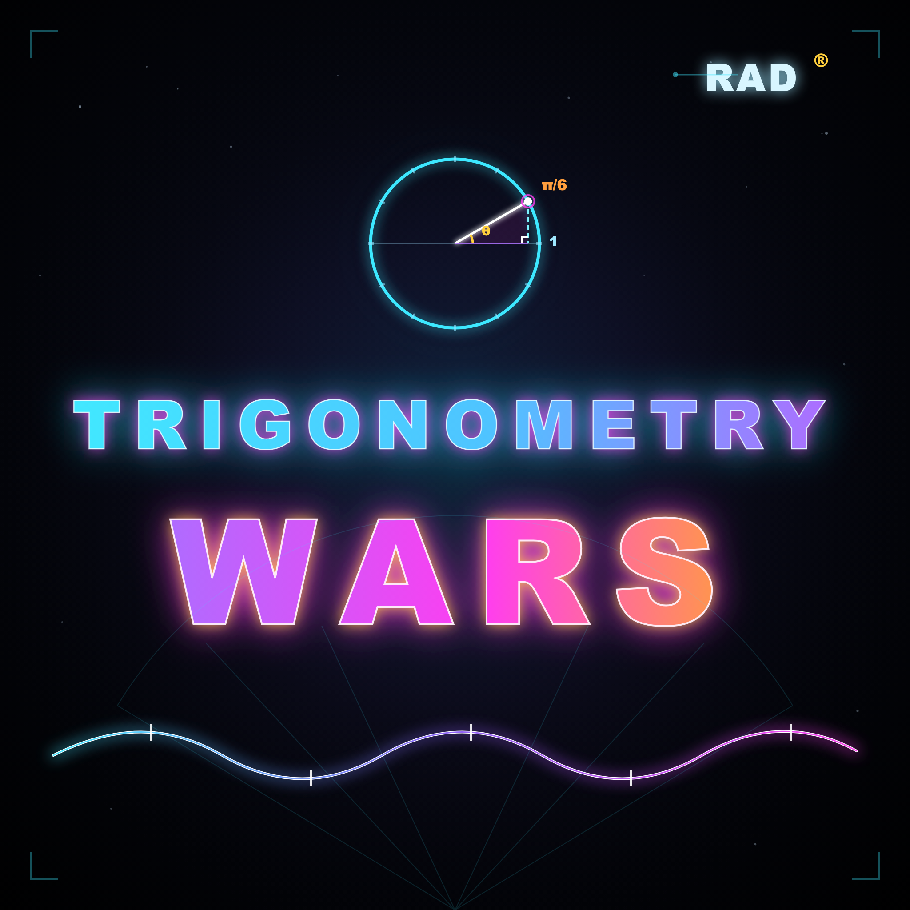

# Trigonometry Wars
## Screenshot Guide & UI Callouts

> A visual reference guide for the game screens, menus, and controls.

---

## 1. Title Screen

[Title screen mockup]

+-------------------------------------------------------+
|                    TRIGONOMETRY WARS                 |
|                                                       |
|  [ Start Game ]        [ Options ]                   |
|  [ High Scores ]       [ Exit ]                       |
|                                                       |
|  Callouts:                                            |
|  - Main menu selection                                |
|  - Start game entry                                   |
|  - Graphics options                                    |
|  - High scores screen                                  |
+-------------------------------------------------------+

### UI callouts

- Main menu: select mode, start, or access settings.
- Options: choose display, bloom, smoothing, and vsync.
- High score screen: view top-ranked runs and best survivors.

---

## 2. Game Mode Select Screen

[Game mode screen mockup]

+-------------------------------------------------------+
|                    SELECT MODE                        |
|                                                       |
|  [ Single Player ]                                    |
|  [ Co-op ]                                            |
|  [ Versus ]                                           |
|                                                       |
|  Controls:                                            |
|  - Up/Down to move                                     |
|  - Enter/Start to confirm                              |
|  - Back to return to title                             |
+-------------------------------------------------------+

### UI callouts

- Each mode changes how many ships are active.
- Co-op and versus require more coordination and input.
- Start button confirms the selected mode.

---

## 3. Graphics Options Screen

[Graphics options screen mockup]

+-------------------------------------------------------+
|                    GRAPHICS OPTIONS                   |
|                                                       |
|  Fullscreen: [ On / Off ]                             |
|  Resolution: [ 1280x720 / 1920x1080 ]                  |
|  Glow: [ High / Medium / Low ]                         |
|  Smoothing: [ On / Off ]                               |
|  Vsync: [ On / Off ]                                   |
|                                                       |
|  [ Apply ]     [ Back ]                                |
+-------------------------------------------------------+

### UI callouts

- Fullscreen toggles borderless or desktop display mode.
- Resolution affects the viewport size.
- Glow changes the neon bloom intensity.
- Vsync locks the frame timing to the display.

---

## 4. High Score Screen

[High score screen mockup]

+-------------------------------------------------------+
|                     TOP SCORES                        |
|                                                       |
|  1. PLAYER 1  125000                                  |
|  2. PLAYER 2   99000                                   |
|  3. PLAYER 3   87000                                   |
|                                                       |
|  [ Back ]                                             |
+-------------------------------------------------------+

### UI callouts

- High scores persist across runs.
- Scores are tied to survival and enemy elimination.
- Back returns to the previous menu.

---

## 5. In-Game Battle View

[Gameplay screen mockup]

+-------------------------------------------------------+
|                   ARENA VIEW                          |
|                                                       |
|  Player ship   o                                     |
|                 \  |  /                               |
|                  \ | /                                |
|                   ^                                   |
|                   |  Enemy wave approaching           |
|                                                       |
|  HUD markers:                                         |
|  - Score counter                                      |
|  - Health / shields                                    |
|  - Threat direction                                   |
|  - Enemy swarm density                                 |
+-------------------------------------------------------+

### UI callouts

- Your ship stays in the center of the action.
- Enemy formations approach from multiple directions.
- Keep your ship in motion to avoid being trapped.
- Threat density increases as more enemies close in.

---

## 6. Pause Menu

[Pause menu mockup]

+-------------------------------------------------------+
|                       PAUSED                          |
|                                                       |
|  [ Resume ]                                            |
|  [ Options ]                                           |
|  [ Quit to Title ]                                     |
|                                                       |
+-------------------------------------------------------+

### UI callouts

- Resume returns you to the match.
- Options changes graphics and gameplay preferences.
- Quit to Title ends the current run.

---

## 7. Control Reference Card

### Keyboard

- `W A S D` — move
- Arrow keys — aim
- `Space` — fire
- `P` — pause
- `Backspace` — back / cancel
- `O` — options

### Gamepad

- Left stick / D-pad — move
- Right stick — aim
- Trigger — fire
- Start — start / pause
- Back — menu action

---

## 8. Player Tips

- Always keep moving when enemies begin to cluster.
- Aim slightly ahead of fast-moving targets.
- Watch the edges of the arena when danger is high.
- Use shield and bomb timing wisely.
- Avoid standing in a straight line with incoming waves.

---

## 9. Quick Visual Checklist

Before each run:

- Confirm your control scheme
- Choose the correct mode
- Check graphics quality
- Review your score objective
- Stay mobile and aim early

---

## 10. Final Note

Trigonometry Wars is built around quick decisions and disciplined movement. The best players survive by controlling space, keeping their aim consistent, and reacting to the emerging wave patterns.

If you want this guide to be turned into a true print-ready product sheet, the next step would be to add real in-game screenshots captured from the game itself.
